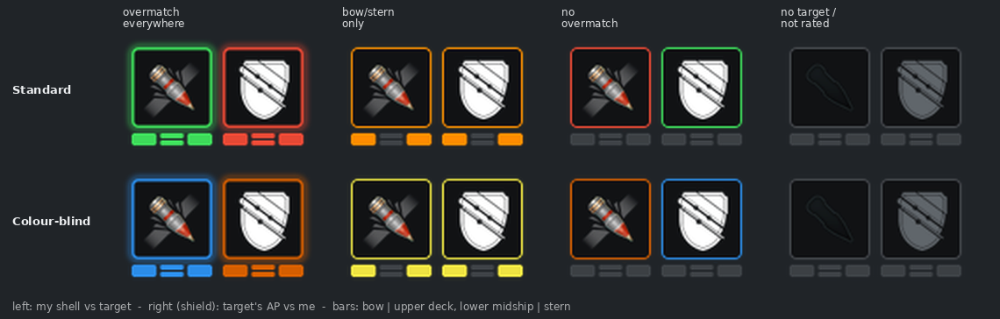
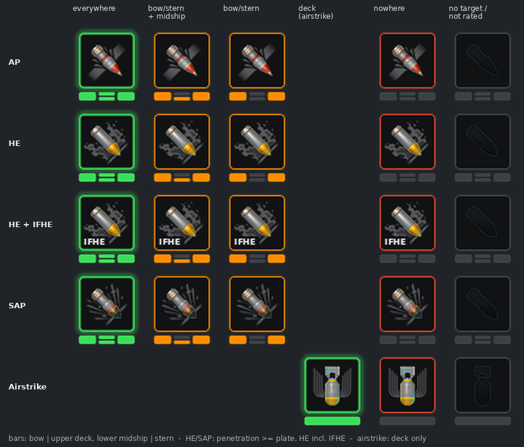
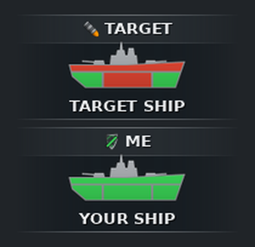
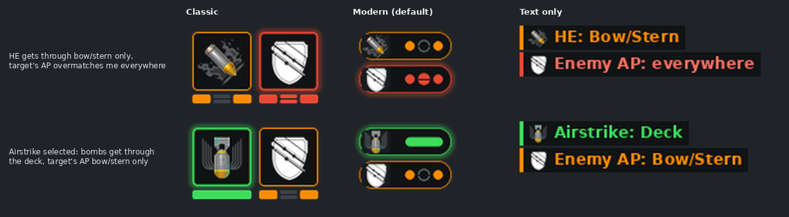

# PenLight

[English](README.md) · **Deutsch**

*PenLight = **Pen**etration (Durchschlag) + **Light** (Ampel).*

**Overmatch- und Durchschlags-Anzeige für World of Warships.** Schaltest du ein Ziel auf, zeigt
PenLight direkt neben dem Fadenkreuz zwei kleine Ampeln:

- **Mein Schuss → Ziel:** Kommt meine **geladene** Munition durch die Panzerung des Ziels? AP wird
  nach Overmatch bewertet, HE und SAP nach ihrem Durchschlagswert. Ist der **Luftschlag** gewählt
  (z. B. niederländische Kreuzer), werden seine HE-Bomben gegen das Deck bewertet.
- **Ziel → ich:** Können die AP-Granaten des Ziels meine Panzerung overmatchen?

Die Anzeige sieht aus wie die Munitionsleiste des Spiels: das Symbol deiner geladenen Munition
(bzw. des Luftschlags) und ein Schild, eingerahmt in der Ampelfarbe. Zur Wahl stehen drei
[Darstellungen](#darstellung): **Klassisch** (Munitions-Slots), **Modern** (Kapseln, Standard) und
**Nur Text**. Mit gedrückter **Alt**-Taste zeigt eine Detailansicht dasselbe für jede Zone beider
Schiffe: Bug/Heck, Mitte und Deck.

Die Anzeige erscheint nur in der **gezoomten Zielansicht** (Fernglas / Zielfernrohr) und solange
der Luftschlag gewählt ist. In der normalen Außenperspektive ist sie ausgeblendet.

> **Aktuelle Version: 0.5.0** (Vorabversion) – [Download unter Releases](https://github.com/DieDreiBeiden/wows-PenLight/releases).
>
> Informationsanzeige über die offizielle ModsAPI des Spiels. Sie vergleicht nur statische
> Panzerungs- und Kaliberwerte, wie die Panzerungsansicht im Hafen – siehe [Fair Play](#fair-play).
> Getestet mit dem EU-Client, Build 15.9.0.13357625 (Linux/Steam).

---

## Inhalt

- [Was angezeigt wird](#was-angezeigt-wird)
- [Fair Play](#fair-play)
- [Branches](#branches)
- [Installation](#installation)
- [Bedienung](#bedienung)
- [Nach einem Spiel-Patch](#nach-einem-spiel-patch)
- [Entwicklung](#entwicklung)
- [Projektstruktur](#projektstruktur)
- [Datenquellen und Danksagungen](#datenquellen-und-danksagungen)
- [Autoren](#autoren)

---

## Was angezeigt wird

### Bewertete Zonen

Jedes Schiff ist in drei Zonen geteilt: **Bug/Heck**, **Mitte** und **Deck**. Welche Schiffe
bewertet werden, hängt von der geladenen Munition ab:

- **AP** und **Schild**: nur, wenn dein eigenes Schiff und das Ziel beide **Kreuzer oder
  Schlachtschiffe** sind.
- **HE und SAP**: von Zerstörern, Kreuzern und Schlachtschiffen gegen Zerstörer, Kreuzer,
  Schlachtschiffe und Träger. Ist die Paarung keine Kreuzer/Schlachtschiff-Paarung, bleibt der
  Teil „Ziel → ich“ grau. Träger werden nur als Ziel bewertet, U-Boote gar nicht.
- **Luftschlag** (HE-Bomben): wie HE, bewertet wird aber nur das **Deck**.

Ohne Ziel oder bei einer nicht bewerteten Paarung bleibt die Anzeige grau.

### Overmatch (AP)

Eine Granate overmatcht eine Panzerplatte, wenn

```
Kaliber > 14,3 × Plattendicke
```

Dann durchschlägt sie diese Platte bei jedem Auftreffwinkel; Anwinkeln hilft nicht. Gleichstand
zählt nicht als Overmatch.

### Die Ampel

<p align="center">
  
</p>

Die Bilder in diesem Abschnitt zeigen die Darstellung **Klassisch**; Modern und Nur Text nutzen
dieselben Farben und Zustände (siehe [Darstellung](#darstellung)).

- **Linker Slot – mein Schuss → Ziel:** das Symbol der geladenen Munition, wie in der
  Munitionsleiste des Spiels.
- **Rechter Slot – Ziel → ich:** ein Schild (Symbol einer Kapitänsfertigkeit); er steht immer für
  die **AP des Ziels**.

Die Farben zeigen, ob die Lage **gut oder schlecht für dich** ist. Deshalb haben die beiden Slots
beim gleichen Ergebnis entgegengesetzte Farben:

| Overmatch auf … | Linker Slot (meine AP → Ziel) | Schild (AP des Ziels → ich) |
|---|---|---|
| allen drei Zonen | **Grün + Leuchten** – ich komme überall durch, auch wenn das Ziel anwinkelt | **Rot + Leuchten** – das Ziel kommt überall durch, seinen Geschützen ausweichen |
| einigen Zonen (z. B. Bug/Heck) | **Orange** – auf die leuchtenden Zonen zielen | **Orange** – diese Zonen aus seinem Feuer halten |
| keiner Zone | **Rot** – nur die Breitseite lohnt | **Grün** – Anwinkeln schützt dich |
| keine Bewertung | Grau, Symbole abgedunkelt | Grau, Symbole abgedunkelt |

Die **Balken** unter jedem Slot tragen dieselbe Aussage ohne Farbe, damit alles auch bei
Farbsehschwäche lesbar bleibt. Sie sind angeordnet wie ein Schiff von der Seite: links **Bug**,
rechts **Heck** (beide stehen für Bug/Heck), in der Mitte eine geteilte Sektion – **obere Hälfte
Deck, untere Hälfte Mitte**. Eine leuchtende Sektion heißt „kommt hier durch“. Modern nutzt Punkte
in derselben Reihenfolge, der mittlere Punkt ist genauso geteilt. Das Leuchten pulsiert beim
Aufschalten kurz.

Für Rot-Grün-Schwäche gibt es ein Farbschema in Blau/Gelb/Orange (Okabe-Ito-Palette).

### HE und SAP

Der linke Slot bewertet immer die **gerade geladene Munition** und zeigt ihr Spiel-Symbol (AP, HE
oder SAP).

HE und SAP overmatchen nicht; sie durchschlagen eine Platte, wenn ihr Durchschlagswert mindestens
so groß ist wie die Plattendicke:

- Durchschlagswerte werden immer auf ganze Millimeter abgerundet; Gleichstand zählt als Durchschlag.
- Für HE nutzt PenLight den Durchschlags-Modifikator, den das Spiel für dein Schiff meldet; die
  Kapitänsfertigkeit **IFHE** ist also enthalten. Ist IFHE aktiv, erscheint links unten am
  HE-Symbol eine kleine Plakette **IFHE**. SAP ist von IFHE nicht betroffen.
- Die Farbe folgt derselben Regel wie bei AP: Grün = überall, Orange = einige Zonen,
  Rot = nirgends.

<p align="center">
  
</p>

Der Schild hängt nicht von deiner Munition ab: Er zeigt immer, ob die **AP des Ziels** dich
overmatchen kann.

### Luftschlag

Einige Schiffe (vor allem niederländische Kreuzer) haben einen **Luftschlag mit HE-Bomben**.
Wählst du ihn, wechselt der linke Slot auf das Luftschlag-Symbol und bewertet den Durchschlag der
Bombe nur gegen das **Deck** des Ziels – Bomben treffen von oben:

- **Grün** mit Leuchten, die einzelne Deck-Sektion leuchtet: Die Bomben durchschlagen das Deck.
- **Rot**, Sektion leer: Sie tun es nicht.

Statt drei Sektionen zeigen Balken (Klassisch) bzw. Kapsel (Modern) nur diese eine.

Der Durchschlag ist der Wert der Bombe, wie ihn das Spiel meldet (IFHE wirkt hier nicht). Die
Anzeige bleibt sichtbar, solange der Luftschlag gewählt ist, auch außerhalb der Zielansicht.
Wechselst du zurück auf die Hauptbewaffnung, zeigt PenLight wieder die geladene Granate.

### Detailansicht (Alt)



In der Darstellung Klassisch ersetzen mit gedrückter **Alt**-Taste zwei untereinander stehende
Schiffe Granate und Schild:

- **TARGET** oben: durch welche Zonen des Ziels meine geladene Granate kommt (AP: Overmatch,
  HE/SAP: Durchschlag, hier auch für die Mitte).
- **ME** unten: welche meiner Zonen die AP des Ziels overmatcht.
- In dieser Ansicht heißt Grün immer **kommt durch**, für TARGET und ME gleich. Nur die normale
  Ansicht färbt nach gut/schlecht für dich.
- Im Spiel werden die **Schiffs-Silhouetten aus dem Lebensbalken** eingefärbt: der Rumpf geteilt
  in Heck, Mitte und Bug, alles oberhalb der Decklinie zählt als Deck. Darunter steht der
  Schiffsname.
- Die Abbildung hier zeigt ein gezeichnetes Schiff. Dieselben gezeichneten Schiffe springen im
  Spiel ein, wenn eine Silhouette fehlt.
- Optional ersetzt die Detailansicht die Symbole dauerhaft; das Farbenblind-Schema gilt auch hier.

Bewusste Vereinfachung: Die Zitadelle wird nicht bewertet. Grün heißt, die äußere Beplankung wird
durchschlagen, nicht, dass du die Zitadelle triffst.

<br clear="right">

### Darstellung

In TTaro Mod Config → PenLight → **Darstellung** wählst du, wie das Ergebnis erscheint:

| Darstellung | Normale Ansicht | Mit Alt |
|---|---|---|
| **Klassisch** | zwei Munitions-Slots mit Balken wie oben | Schiffe je Zone wie oben |
| **Modern** (Standard) | zwei Kapseln mit Munitions-Symbol bzw. Schild: oben mein Schuss → Ziel, unten AP des Ziels → ich; Punkte für Bug, Deck/Mitte (geteilt) und Heck | ausgeklappte Kapseln mit Plattendicke je Zone und dem Schuss (Durchschlag bzw. Kaliber und Overmatch-Grenze) |
| **Nur Text** | zwei Zeilen auf dunkler Unterlage mit Farbstreifen und kleinem Symbol, z. B. „HE: Bug/Heck“ und „Gegner-AP: überall“, in den Ampelfarben | Kopfzeile, Zonenname und Plattendicke als Text |

<p align="center">
  
</p>

- Alle Darstellungen folgen dem Farbenblind-Schema. Nicht bewertete Paarungen bleiben grau.
- „Nur Text“ ist auf Kontrast geprüft (mindestens 4,5 : 1, auch vor heller Gischt).
- Die Texte von Modern und Nur Text folgen der Client-Sprache (20 Sprachen), wenn AndrewTaros
  LocalizationLoader installiert ist, sonst Englisch.

---

## Fair Play

PenLight ist eine Informationsanzeige. Sie beantwortet dieselbe Frage wie die Panzerungsansicht
im Hafen – „ist diese Platte dünner als das, was meine Granate durchschlägt?“ – für das
aufgeschaltete Schiff.

**Was sie im Gefecht liest** (offizielle ModsAPI und Oberflächendaten des Spiels):

- die Spielerliste, wie sie ohnehin in den Teamlisten steht: Spieler-ID, Name und Team sowie das
  Schiff jedes Spielers – ID und Name nur, um das aufgeschaltete Ziel zuzuordnen;
- welches Schiff du aufgeschaltet hast, dazu dessen Namen und Lebensbalken-Silhouette für die
  Detailansicht;
- deine **eigene** geladene Munition der Hauptbewaffnung mit ihren festen Werten, deinen
  **eigenen** HE-Durchschlags-Modifikator (z. B. die Kapitänsfertigkeit IFHE) und ob **du** deinen
  Luftschlag gewählt hast, mit den festen Werten seiner Bomben;
- den Kameramodus (Zielansicht, Alt) und ob dein eigenes Schiff lebt, um die Anzeige ein- oder
  auszublenden.

**Was sie nicht tut:**

- Sonst liest sie über andere Spieler nichts: keine Positionen, Aufklärung, Lebenspunkte,
  Nachladezeiten, geladene Munition (der Teil „Ziel → ich“ geht immer von der AP des Ziels aus),
  Verbrauchsgüter oder Ausrüstung.
- Keine Zielhilfe, keine Vorhalte- oder Flugbahnberechnung, keine automatischen Eingaben.
- Keine Änderung an Spieldateien, Schiffswerten oder Spielregeln. Keine ausführbaren Dateien oder
  DLLs; alles liegt in `res_mods`, Einstellungen in `ModPrefs`.

Panzerung und Kaliber sind statische Schiffsdaten. Sie werden offline aus der Client-Datei
`GameParams.data` ausgelesen und als Tabelle (`ships.json`) für genau eine Spielversion
mitgeliefert.

---

## Branches

| Branch | Zweck |
|---|---|
| `main` | die veröffentlichte Fassung; benötigt ModForge **und** TTaroModUtils |
| `Test` | Probe-Builds, die erst im Spiel getestet werden; nicht veröffentlicht |
| `Test-Standalone` | experimentelle Fassung, die auch **ohne TTaroModUtils** läuft (Tastenkürzel, Flash-Greiffläche); nicht veröffentlicht |

---

## Installation

**Voraussetzungen**

- [ModForge](https://github.com/AndrewTaro/ModForge) – hängt die Anzeige ins Gefecht ein.
- [TTaroModUtils](https://github.com/AndrewTaro/TTaroModUtils) – Optionsseite, Zahnrad und Verschieben.
- Optional: AndrewTaros LocalizationLoader – Texte in der Client-Sprache statt Englisch.

**Schritte**

1. `PenLight-<Version>.zip` unter [Releases](https://github.com/DieDreiBeiden/wows-PenLight/releases) herunterladen.
2. Spiel beenden.
3. Im Spielordner unter `bin/` den Ordner mit der **höchsten Nummer** suchen,
   z. B. `bin/13357625/`.
   - Steam unter Linux: `~/.local/share/Steam/steamapps/common/World of Warships/`
   - Windows: meist `C:\Games\World_of_Warships\`
4. Das Archiv nach `bin/<Nummer>/` entpacken, sodass sich sein Ordner `res_mods` mit dem
   vorhandenen zusammenführt, und vorhandene PenLight-Dateien überschreiben. (Ohne Release: den
   Inhalt von [`mod/res_mods/`](mod/res_mods) aus dem Branch kopieren.)
5. Spiel starten. Liegt danach `res_mods/PnFMods/PenLight/penlight_log.txt` vor,
   wurde die Mod geladen.

Ausführlichere Hinweise und Diagnose: [`mod/README.md`](mod/README.md).

**Entfernen:** die PenLight-Dateien aus `res_mods` löschen (`PnFMods/PenLight/`,
`gui/unbound2/PnFMods/PenLight*.unbound`, `ForgeBlueprints/PenLightContainer.xml`,
`ModSchemas/diedreibeiden-penlight.schema.json`, `texts/*/penlight.mo`). Die frühere Standalone-
Fassung speicherte ihre Einstellungen zusätzlich in `World of Warships/ModPrefs/diedreibeiden-penlight.json`.

---

## Bedienung

Im Gefecht in die Zielansicht wechseln und **Strg** halten, damit der Mauszeiger erscheint:

- Symbole greifen und **ziehen**, um die Anzeige zu verschieben.
- **Zahnrad** links neben der Anzeige öffnet die PenLight-Seite in TTaro Mod Config:
  Darstellung (Klassisch / Modern / Nur Text), Darstellungsmodus (Detail mit Alt / immer),
  Farben (Standard / Farbenblind),
  Größenskalierung, Verschieben sperren, Position zurücksetzen.

---

## Nach einem Spiel-Patch

Panzerung und Kaliber stammen aus der Spieldatei `content/GameParams.data` und gelten für genau
eine Spielversion. Passt `ships.json` nicht zur laufenden Version, schaltet sich die Mod ab
(lieber nichts anzeigen als falsche Farben) und schreibt das ins Log.

```bash
# 1. GameParams.data mit dem WoWs Unpack Tool aus dem Client extrahieren
# 2. Tabelle erzeugen (Version so, wie sie im python.log steht)
python3 -I tools/gameparams.py GameParams.data ships_full.json \
    mod/res_mods/PnFMods/PenLight/ships.json 15,9,0,13357625
# 3. Mod bauen und testen
python3 -I tools/build_mod.py
python3 -m unittest discover -s tests
```

Die Schiffs-Silhouetten liefert das Spiel selbst; sie passen sich jedem Patch automatisch an.

---

## Entwicklung

| Aufgabe | Befehl |
|---|---|
| Tests | `python3 -m unittest discover -s tests` |
| `Main.py` erzeugen (aus `src/penlight/`) | `python3 -I tools/build_mod.py` |
| Icons für Granate, Schild, HE/SAP, Plaketten und Zeichen zeichnen | `python3 -I tools/make_ampel_icons.py` |
| Detail-Bilder, Beschriftungen, Rahmen | `python3 -I tools/make_detail_icons.py` |
| Status-Kapseln und Alt-Flächen (Modern) | `python3 -I tools/make_capsule_icons.py` |
| Munitionsleisten-Design: Slots, Balken, Kapseln, Streifen, Leuchtringe | `python3 -I tools/make_ammobar_icons.py` |
| Abbildungen der README | `python3 -I tools/make_readme_images.py` |
| Texte der TTaro-Optionsseite | `python3 -I tools/make_texts.py` |
| To-Do-Liste | [`docs/TODO.md`](docs/TODO.md) |
| Release | GitHub: Actions → Release → Run workflow (auf `main`). Version = nächste Patch-Version, sofern nicht angegeben; der Workflow schreibt sie in `ForgeBlueprints/PenLightContainer.xml` und in die Versionszeile der README, ModForge sieht also immer die Release-Version. Neuerungen = „Unreleased“ in `docs/CHANGELOG.md`, Rahmen in `docs/RELEASE_NOTES.md` |
| Release-Vorschau | Gleicher Workflow mit `dry_run`: Text in der Zusammenfassung des Laufs, Zip als Download am Lauf, nichts gepusht oder veröffentlicht |
| Prüfung bei jedem Push | Workflow Check: Tests, `Main.py` aktuell, Python-2.7-Syntax |
| Probe-Build aus `Test` / `Test-Standalone` | Workflow Check nach jedem Push: `res_mods` als Download am Lauf (14 Tage), kein Release |

- Die Spiel-Logik (`src/penlight/logic.py`) läuft unter Python 2.7 (Client) und 3.x (Tests).
- `mod/res_mods/PnFMods/PenLight/Main.py` ist generiert – Änderungen in `src/penlight/`.
- PenLights eigene Grafiken (Rahmen, Balken, Kapseln, Farben) werden per Skript gezeichnet. Die
  Symbole für Munition, Luftschlag und Schild sind Kopien aus den Spieldateien (siehe
  [Quellen](#datenquellen-und-danksagungen)).
- Konzept, Ampel-Logik und gesammelte Befunde zum Client: [`docs/KONZEPT.md`](docs/KONZEPT.md).

---

## Projektstruktur

```
mod/res_mods/                     Dateien so, wie sie in bin/<Build>/res_mods/ gehören
  PnFMods/PenLight/               Main.py (generiert), ships.json, Icons, capsule/, ammobar/
  PnFMods/PenLight/ammobar/game/  Symbole für Munition, Luftschlag und Schild, aus dem Spiel kopiert
  gui/unbound2/PnFMods/           PenLight*.unbound – die Anzeige (Unbound 2)
  ForgeBlueprints/                ModForge-Manifest
  ModSchemas/, texts/             Optionsseite für TTaro Mod Config
src/penlight/                     logic.py (Ampel), mod_main.py (Anbindung an den Client)
tools/                            GameParams-Auswertung, Build, Icon-Generatoren
tests/                            Unit-Tests inkl. nachgebautem Client
docs/                             Konzept, Abbildungen
```

---

## Datenquellen und Danksagungen

- **Panzerung und Kaliber:** `GameParams.data` des Spielclients, ausgewertet mit
  [`tools/gameparams.py`](tools/gameparams.py); Namen der Panzerungsmaterialien aus
  [wowsunpack](https://github.com/landaire/wowsunpack) (MIT).
- **ModsAPI** von Wargaming/Lesta (offizielle Dokumentation).
- **Symbole für Munition, Luftschlag und Schild** (`ammobar/game/`): © Wargaming.net, unverändert
  aus den Client-Dateien kopiert (Symbole der Munitionsleiste und das Fertigkeitssymbol
  `planes_ap_damage`), damit die Anzeige zum HUD des Spiels passt – wie bei anderen Mods üblich.
  Sie bleiben Eigentum von Wargaming.
- **ModForge**, **TTaroModUtils** und **LocalizationLoader** von [AndrewTaro](https://github.com/AndrewTaro):
  werden als Abhängigkeiten genutzt (LocalizationLoader optional), aber nicht mitgeliefert. Ihr Code und der seines PenetrationCalculator
  (für die Munitions-API) diente nur als Referenz; übernommen wurde nichts.
- Die Erkennung des aufgeschalteten Ziels in Unbound folgt dem Muster von XTargetTracker
  (Battle Expert); übernommen wurde kein Code.

PenLight nutzt ausschließlich die offizielle ModsAPI bzw. die veröffentlichten Schnittstellen
der genannten Mods. Eine Lizenz für dieses Repository ist noch nicht festgelegt.

---

## Autoren

- [DieDreiBeiden](https://github.com/DieDreiBeiden) – Idee, Gestaltungsentscheidungen, Tests im Spiel
- Claude (Anthropic) – Umsetzung, als Mitautor der Commits
