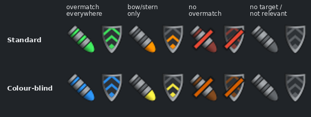
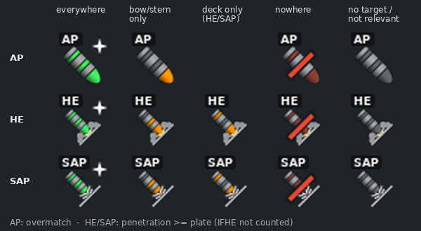
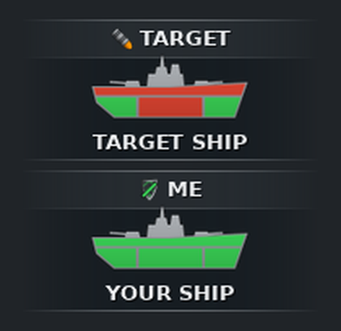

# PenLight

**English** · [Deutsch](README.de.md)

*PenLight = **pen**etration + traffic **light**.*

**Overmatch and penetration indicator for World of Warships.** When you lock onto a cruiser or
a battleship, PenLight shows two traffic lights right next to your crosshair:

- **Shell:** does my **loaded** ammunition get through the target? AP is rated by overmatch,
  HE and SAP by their penetration against the target's plating.
- **Shield:** can the target's AP overmatch me?

Hold **Alt** for a detail view: the game's own ship silhouettes, split into **bow/stern**,
**midship** and **deck**, each green (gets through) or red (does not).

<p align="center">
  
</p>

> Interface mod built on the game's official ModsAPI. Tested with the EU client,
> build 15.9.0.13357625 (Linux/Steam).

---

## Contents

- [What it shows](#what-it-shows)
- [Editions and branches](#editions-and-branches)
- [Installation](#installation)
- [Usage](#usage)
- [After a game patch](#after-a-game-patch)
- [Development](#development)
- [Repository layout](#repository-layout)
- [Data sources and credits](#data-sources-and-credits)

---

## What it shows

### The overmatch rule

A shell overmatches an armour plate when

```
calibre > 14.3 × plate thickness
```

It then penetrates the plate regardless of impact angle, even against an angled ship.
A tie does not count as overmatch.

### The traffic light

Bow/stern is the precondition; "everywhere" requires midship **and** deck to be overmatched as
well. The colours tell you whether the situation is **good or bad for you**:

| Bow/stern | Midship and deck | Shell (me → target) | Shield (target → me) |
|---|---|---|---|
| yes | both yes | **Green + star** – I get through everywhere, even angled | **Red + warning triangle** – the target gets through everywhere, dodge |
| yes | not both | Orange – aim at bow/stern | Orange – protect your bow/stern |
| no | – | Red – only a broadside is worth it | Green – angling works |
| – | – | Grey – no target, or a destroyer/carrier/submarine | Grey |

The **shape** carries the same message without colour. Shell: all segments filled = I get
through everywhere, only the tip = bow/stern only, slash = I don't get through. Shield: full and
intact = the target doesn't get through, partly filled = bow/stern only, **broken** = the target
gets through everywhere. Star and warning triangle flash briefly when you lock a target.
Together this stays readable with colour vision deficiency.

Only pairings of **cruisers and battleships** are rated; everything else stays grey.
A colour-blind scheme in blue/yellow/orange (Okabe-Ito palette) is available for red-green
colour vision deficiency.

### HE and SAP

The shell always rates the **ammunition currently loaded**; a small tag (AP / HE / SAP) like on
the ammo slots in the HUD shows which. HE and SAP have their own drawings modelled on the game's ammo
icons: HE hitting a surface and exploding (smoke and flash), SAP hitting a surface with splinters.
The tip carries the traffic-light colour, as with AP. Instead of overmatch they check the
penetration value of the shell against the target's plating. Penetration is always rounded down to
whole millimetres, and penetration ≥ plate counts. For HE the game's own modifier for your ship is
applied, so the **IFHE** commander skill is included; when it is active, a small **IFHE** tag
appears at the bottom left of the HE shell. SAP is not affected by IFHE:

<p align="center">
  
</p>

| Bow/stern | Deck | Shell |
|---|---|---|
| yes | yes | Green + star – tip, band and ring filled |
| yes | no | Orange – tip and band (middle) filled |
| no | yes | Orange – tip and rear ring filled |
| no | no | Red – slash |
| – | – | Grey – no target, or a destroyer/carrier/submarine |

The shield always stays the enemy's AP overmatch. In the detail view the TARGET ship shows the
penetration of the loaded HE/SAP.

### Detail view (Alt)



Holding **Alt** replaces shell and shield with two ships stacked on top of each other:

- **TARGET** on top: where my loaded shell gets through the target (AP: overmatch, HE/SAP:
  penetration of bow/stern, midship and deck).
- **ME** below: where the target's AP overmatches me.
- Here green always means **gets through** – for Target and Me alike. (Only the normal view
  colours by good/bad for you.)
- Each ship sits in a dark band that fades out to the sides, with hairlines and a slightly
  lighter header. The small shell/shield icon in the header carries the colour of the big icon.
- In game the **ship silhouettes from the health bar** are coloured in: the hull is split into
  stern, midship and bow, everything above the deck line counts as deck. The silhouette gets a
  dark outline and a soft shadow, the ship name (in the game font) sits underneath.
- The image uses a drawn ship instead of the game silhouette, since no game assets are shipped.
  The same drawn ships also stand in when no silhouette is found.
- Optionally the detail view can replace the icons permanently, and it follows the
  colour-blind scheme as well.

Deliberate simplification: the citadel belt is not rated. Green means the plating is
overmatched, not a citadel hit.

<br clear="right">

---

## Editions and branches

| Branch | Requires | Settings | Moving the display |
|---|---|---|---|
| `main` | ModForge **and** TTaroModUtils | options page in TTaro Mod Config, gear button on the display | mouse (TTaro) |
| `main-standalone` | ModForge; TTaroModUtils **optional** | with TTaro as on `main`, otherwise hotkeys | with TTaro via TTaro, otherwise mouse via its own Flash part |

`main-standalone` detects TTaroModUtils automatically: ModForge mounts one of two wrappers
depending on what is installed, and `Main.py` switches its own controls off as soon as TTaro is present.

---

## Installation

**Requirements**

- [ModForge](https://github.com/AndrewTaro/ModForge) – mounts the display in battle.
- For `main` additionally [TTaroModUtils](https://github.com/AndrewTaro/TTaroModUtils);
  optional for `main-standalone`.

**Steps**

1. Close the game.
2. In the game folder, find the folder with the **highest number** under `bin/`,
   e.g. `bin/13357625/`.
   - Steam on Linux: `~/.local/share/Steam/steamapps/common/World of Warships/`
   - Windows: usually `C:\Games\World_of_Warships\`
3. Copy the contents of [`mod/res_mods/`](mod/res_mods) into `bin/<number>/res_mods/` and
   overwrite existing PenLight files.
4. Start the game. If `res_mods/PnFMods/PenLight/penlight_log.txt` exists afterwards,
   the mod was loaded.

More detailed notes and diagnostics (German): [`mod/README.md`](mod/README.md).

**Uninstall:** delete the PenLight files from `res_mods` (`PnFMods/PenLight/`,
`gui/unbound2/PnFMods/PenLight*.unbound`, `ForgeBlueprints/PenLightContainer.xml`,
`ModSchemas/diedreibeiden-penlight.schema.json`, `texts/*/penlight.mo`).

---

## Usage

### With TTaroModUtils

In battle, hold **Ctrl** to show the mouse cursor:

- Grab the icons and **drag** to move the display.
- The **gear** to the left of the display opens the PenLight page in TTaro Mod Config:
  display mode (detail on Alt / always), colours (standard / colour-blind),
  size scale, lock dragging, reset position.

### Without TTaroModUtils (`main-standalone`)

- **Drag** with the mouse: hold Ctrl, hover over shell | shield (a thin frame appears), drag.
- **Hotkeys** with **Ctrl+Alt**:

| Key | Effect |
|---|---|
| Arrow keys | move, 5 px (1 px with Shift) |
| Home | reset position |
| D | detail view: on Alt ↔ always |
| F | colours: standard ↔ colour-blind |
| + / − | size 0.5–2.0 |

Settings are stored in `World of Warships/ModPrefs/` and survive game patches.

---

## After a game patch

Armour and calibres come from the game file `content/GameParams.data` and apply to exactly one
game version. If `ships.json` does not match the running version, the mod switches itself off
(better nothing than wrong colours) and says so in its log.

```bash
# 1. Extract GameParams.data from the client with the WoWs Unpack Tool
# 2. Build the table (version as written in python.log)
python3 -I tools/gameparams.py GameParams.data ships_full.json \
    mod/res_mods/PnFMods/PenLight/ships.json 15,9,0,13357625
# 3. Build and test the mod
python3 -I tools/build_mod.py
python3 -m unittest discover -s tests
```

The ship silhouettes come from the game itself and follow every patch automatically.

---

## Development

| Task | Command |
|---|---|
| Tests | `python3 -m unittest discover -s tests` |
| Generate `Main.py` (from `src/penlight/`) | `python3 -I tools/build_mod.py` |
| Draw shell/shield icons | `python3 -I tools/make_ampel_icons.py` |
| Detail images, labels, frames | `python3 -I tools/make_detail_icons.py` |
| README images | `python3 -I tools/make_readme_images.py` |
| Texts of the TTaro options page | `python3 -I tools/make_texts.py` |
| Flash part `Main.swf` (`main-standalone`) | `tools/build_flash.py`, requirements in the file header |

- The game logic (`src/penlight/logic.py`) runs on Python 2.7 (client) and 3.x (tests).
- `mod/res_mods/PnFMods/PenLight/Main.py` is generated – edit `src/penlight/` instead.
- All graphics are drawn by scripts; no game assets are shipped.
- Concept, traffic-light logic and notes on the client (German): [`docs/KONZEPT.md`](docs/KONZEPT.md).

---

## Repository layout

```
mod/res_mods/                     files as they belong in bin/<build>/res_mods/
  PnFMods/PenLight/               Main.py (generated), ships.json, icons, (Main.swf)
  gui/unbound2/PnFMods/           PenLight*.unbound – the display (Unbound 2)
  ForgeBlueprints/                ModForge manifest
  ModSchemas/, texts/             options page for TTaro Mod Config
src/penlight/                     logic.py (traffic light), mod_main.py (client binding)
src/as3/                          Flash part for dragging without TTaro (main-standalone)
tools/                            GameParams parsing, build, icon generators
tests/                            unit tests incl. a mocked client
docs/                             concept, images
```

---

## Data sources and credits

- **Armour and calibres:** the client's `GameParams.data`, parsed with
  [`tools/gameparams.py`](tools/gameparams.py); armour material names from
  [wowsunpack](https://github.com/landaire/wowsunpack) (MIT).
- **ModsAPI and ModSDK** by Wargaming/Lesta (official documentation and `wows_library.swc`).
- **ModForge** and **TTaroModUtils** by [AndrewTaro](https://github.com/AndrewTaro): used as
  dependencies, not shipped. Their code served as reference only; nothing was copied.
- Target detection follows the pattern of XTargetTracker (Battle Expert).

PenLight only uses the official ModsAPI and the published interfaces of the mods above.
A licence for this repository has not been chosen yet.
